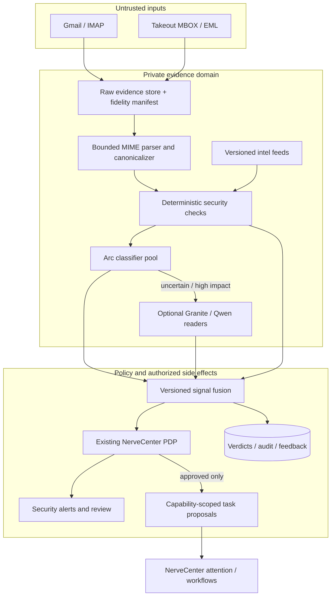
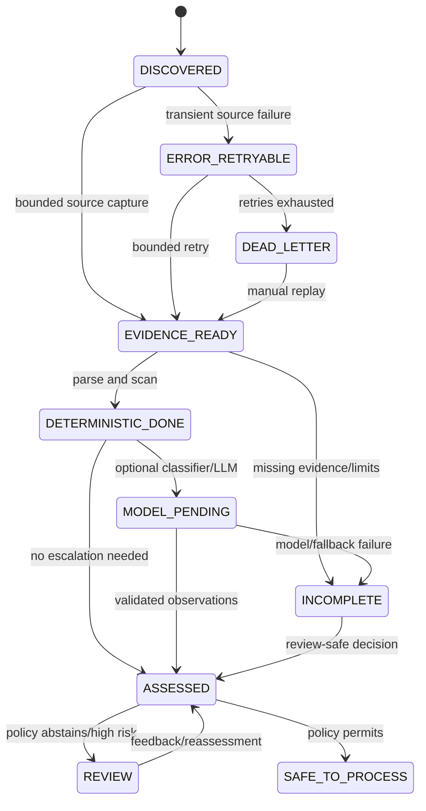

# NerveShield — Technical Design

**Design version:** 1.0  
**Companion files:** [requirements](requirements.md) · [tasks](tasks.md) · [threat model](threat-model.md) · [decisions](decisions.md) · [security verdict schema](schemas/security-assessment.schema.json) · [semantic observation schema](schemas/semantic-observation.schema.json)

## 0. North star: from mail filtering to a personal communications immune system

NerveShield is not a prompt attached to an IMAP inbox. It is a **trust fabric** for inbound communications: deterministic evidence → calibrated classifiers → selective bounded semantic inspection → account-aware contextual interpretation → deterministic authorization → user-relevant outcomes. Over time it should recognize *expectedness*: is this the kind of request this authenticated contact would normally make, at this point in an ongoing relationship or workflow? It should also detect *intent discontinuities*: what changed between an earlier known-good thread and this message? Those observations are not proof that someone is malicious; they become evidence for safe review and verification.

The signature differentiator is **progressive scrutiny with explainable abstention**. Most messages should cost little to classify; a small subset should get powerful model reasoning; a much smaller subset should require the human. The system must know when it does not know. No single LLM should determine tool permissions. A false-positive flood is itself a personal-assistance failure.

### Major product capabilities (roadmap, NOT current)

1. **Provenance passport:** evidence completeness and authenticated identity claims for each message, with explicit `VERIFIED / PROVIDER_REPORTED / UNVERIFIED / UNKNOWN` status.
2. **Threat radar:** campaigns clustered by non-sensitive features and indicators, with expiring intelligence and provenance.
3. **Trust graph:** person/organization/domain relationships, verified prior channels, changed payment endpoints and conversation continuity.
4. **Expectedness engine:** contextual abnormality around a sender, business, thread and obligation; separate from reputation.
5. **Intent firewall:** conversion from suspicious text into narrow proposed actions, guarded by real user authority.
6. **Attention firewall:** avoid interrupting the user about spam and low-priority bulk mail while never silently losing a real obligation.
7. **Immune memory:** explicit feedback, active-learning review, evaluated offline retraining, privacy tests and rollback.
8. **Safety cockpit:** show what happened, what evidence is missing, what models ran and why action was withheld.
9. **Future protocol boundary:** optional SMTP/transport ingress and cross-channel adapters, independently designed and gated.

## 1. Evidence from repository audit (snapshot, reconcile on every run)

Public repo: `https://github.com/celesrenata/nervecenter`, observed `main` head `45ab7626325ee40be7c59d33ba0a871bfb81110f` (Nov 4, 2026 local). The repo has >6,000 paths, some generated/vendor content. Kiro must inspect fresh HEAD and should NOT treat line numbers as stable.

| Existing path | Observed contract | NerveShield use / integration risk |
| --- | --- | --- |
| `backend/connectors/mail/mail_transport.py` | `MailItem` with selected `headers` and `content_bytes`; IMAP and Gmail clients, incremental cursors | **Critical evidence gap:** not necessarily raw RFC822; DKIM/SPF cannot be retrospectively trusted from it. Extend behind safe, optional evidence-capture seam after audit. |
| `backend/ingest/mail_worker.py` | per-account worker; durable cursor/seen/idempotency; body stored via object store, `content_ref` in graph; detection path already invoked | Avoid duplicate ingestion. Add durable security job/outbox seam, not uncontrolled network/model work within cursor-critical transaction. |
| `backend/ingest/mail_flags.py` | persistent bulk/automated/no_reply flags derived from allowlisted headers | Reuse for relevance; do not treat bulk as malicious. |
| `backend/communications/detection/relevance.py` | deterministic classification of `person / machine / bulk`, importance and VIP handling | Preserve existing semantics; keep security risk orthogonal to relevance. |
| `backend/communications/detection/service.py` | `ContentResolver` transient text by `content_ref` and deterministic finding extraction | Security may use dedicated typed evidence resolver, but should not make generic content suddenly accessible to all agents. |
| `backend/communications/detection/assist.py` | model assist currently only refines deterministic findings; off by default | Do **not** force NerveShield semantic extraction through this narrower finding-refinement seam. Add a separate bounded security analysis path. |
| `backend/communications/detection/wiring.py` | detection → followups → attention; durable attention mirror | **Critical action gate:** determine where security trust must be enforced before actionable promotion. Shadow first. |
| `backend/communications/models.py` | `Communication` and sensitivity metadata | Extend minimally; avoid burying full threat evidence in general-purpose communications rows. |
| `backend/inference/omniroute.py` | OmniRoute transport/adapter with route/provider machinery | Reuse transport; verify resolved candidates and PDP policy before every private-content hop. Alias is not proof of local routing. |
| `backend/policy/pdp.py` | fail-closed principal/action/resource/context policy decision point and infer route policy | Use existing authority model for content access, external inference, user approvals and agent actions. |
| `backend/storage/contracts.py` | async `ObjectStore` with put/get/delete/head | Reuse opaque pointers; verify actual encryption and key controls before storing raw archives. |
| `backend/events/` | NATS/JetStream events, envelope, replay, dead-letter logic | Reuse envelope/headers and idempotent delivery semantics. |
| `backend/api/wiring.py` | startup binding of repos, stores, mail ingest, policy | Add opt-in wiring and shutdown. Never start an unconfigured high-privilege scanner by default. |
| `web/src/views/EmailView.tsx` & `CommunicationsView.tsx` | existing mail/communications surfaces | Add safety cards without breaking current triage or allowing active remote content. |

Recent commits include FEAT-001 bulk/automated flag extraction, FEAT-002 relevance scoring, durable attention and leak-prevention work. Protect those decisions with regression tests.

### Mandatory Phase 0 investigations

- Identify **exact sequencing** of raw content persistence, detector content registration, durable communication, follow-up/attention minting, and cursor update for both API and worker ingests.
- Confirm what Gmail API `format` is used, which headers survive, whether attachments are fetched or omitted, and what `content_bytes` actually means.
- Check if current object-storage encryption exists and works in the deployed configuration, including backups, not merely in comments.
- Resolve current DB migration, tenancy and source-identity patterns before inventing tables.
- Verify official OmniRoute route identities, actual model versions, local/cloud fallback, TLS and policy enforcement.
- Inspect NATS publication, queueing, idempotency and dead-letter patterns.
- Identify whether any attention items today can be generated directly from **uninspected** or adversarial email body text.

No production edits until the investigation closes.

## 2. Two planes with a hard boundary

**Evidence and analysis plane** may read sensitive content under controlled local policy and emits observations.  
**Decision and action plane** receives only schema-constrained observations and issues explicitly scoped, audited permissions.

**N.B.** The diagram depicts *logical* flow. In v1, do not introduce unbounded synchronous work in the durable ingestion transaction. Persist a security job reference, consume asynchronously, write a verdict, and use an explicit integration gate. Merely checking a new security verdict *after* legacy attention/action creation is insufficient in enforcing mode.

## 3. Model of trust: six independent axes

Avoid misleading single-dimensional `legitimacy`.

| Axis | Question | Example | Responsible component |
| --- | --- | --- | --- |
| Auth provenance | What actually authenticated? | DKIM provider-reported, ARC untrusted | evidence validator |
| Threat likelihood | Does content resemble a harmful attack? | credential phishing with plausible logos | deterministic + classifier |
| Impact severity | What could occur if acted upon? | payment diversion > newsletter link | policy risk taxonomy |
| Expectedness | Is this normal for this verified relationship/thread? | vendor changed bank details | trust graph / context |
| Personal relevance | Does it matter to this user? | human request > bulk ad | existing relevance + semantic |
| Action eligibility | What may NerveCenter do with it? | create review card but not pay invoice | PDP + approval policy |

Every axis can be `NOT_EVALUATED`, `UNKNOWN` or a qualified observation. A spoofed `Authentication-Results` header is not a verified truth. DKIM success does not prove a sender is well-intentioned.

### State machine (v1)

`ASSESSMENT_STATE` is not the same as `DISPOSITION`: a partial assessment can produce a restrictive `REVIEW` disposition, but never `SAFE_TO_PROCESS` merely because one scan timed out. `SHADOW`, `NOTIFY`, `REVIEW_GATED`, `ENFORCE` are deployment modes, not states. The authoritative schema may evolve after database reconnaissance; version every schema and migration.

## 4. Source provenance and canonical evidence

### 4.1 Ingest envelope

An immutable evidence manifest should record `source_id`, `account_scope`, `provider`, `provider_uid`, `folder_or_label`, `source_message_id`, `acquisition_mode` (`GMAIL_FULL`, `GMAIL_RAW`, `IMAP_RFC822`, `TAKEOUT_MBOX`, `EML`, `LEGACY_BODY_ONLY`), `acquired_at`, `source_time`, `raw_content_ref`, `normalized_content_ref`, `sha256`, `evidence_fidelity`, `missing_parts`, and `auth_provenance`. Allow one logical email to have distinct account-scoped source observations.

### 4.2 Preserve original bytes when possible

Current transports have a **lossy mail item** abstraction, so design optional **evidence capture** without breaking it. If the provider supports full RFC 5322 bytes, save them to the protected object store with content digest and scoped keys. If it does not, record a manifest and parse what exists. Do not invent envelope IP/SPF proof from stored `From`/`Received` fields. For historical Takeout, preserve MBOX offsets/labels and raw message bytes; parse in a resource-limited process.

### 4.3 Parser

Candidate Python standard `email` policy parser plus a hardened wrapper. Add explicit limits for source bytes, MIME depth, part count, header sizes, total decoded bytes, filenames and encodings. Normalize Unicode for display/comparison while retaining raw evidence refs. Extract links from HTML attributes and text, content-ID images, external resources, form actions and suspicious hidden blocks. Archive parser itself must enforce decompression quotas if archives are supported. Avoid Internet lookups by default.

### 4.4 Ingest transaction boundary

Preferred:

1. Existing mail connector fetches an item.
2. Existing worker persists durable communication/content as today.
3. **Same durable transaction if supported**: write idempotent outbox record `mail.security.inspect.requested` using account-scoped source key. If not, use independently recoverable scanner for missing jobs (document limitations).
4. Cursor advances according to existing commit guard, not successful external model completion.
5. Security consumer resolves content with PDP, scans offline, writes verdict/evidence metadata; outbox ack only after committed verdict.
6. In `SHADOW`, existing attention path behavior remains untouched and security evidence is presented separately. In enforcement, the action/attention gate is moved **before** email-derived actionable promotion, with safe review fallback. Never assume wiring exists without testing both API and worker paths.

This is not license to change current cursor semantics in Phase 1. Start with seam and audit logs; prove outbox durability first.

## 5. Deterministic security plane

### 5.1 Auth and provenance

Capture `spf`, `dkim`, `dmarc`, `arc` observations with state `PASS/FAIL/NEUTRAL/UNKNOWN`, provenance `INDEPENDENT/PROVIDER_REPORTED/UNTRUSTED_HEADER`, and evidence IDs. `Authentication-Results` trust depends on known receiver boundaries and source; forgeable headers are `UNTRUSTED_HEADER`. True SPF validation needs original SMTP client IP and envelope; direct historical DKIM verification needs complete unmodified signed MIME plus DNS keys with historical-key limitations; DMARC alignment must not be invented. ARC is not a generic safety badge.

### 5.2 Offline inspections

- Address/domain: unicode/IDNA canonicalization, display-name confusion, reply-to, sender mismatch, case and aliases, known relationship candidates.
- URL: percent-encoding normalization, registrable-domain parsing, subdomain deception, visible-text mismatch, confusables, shortened links, QR content only if locally decoded; no clicks.
- HTML: remote resources, tracking pixel heuristics, forms, hidden text, JavaScript and active content indicators; **never render active content**.
- Attachments: MIME and magic sniffing, double extension, archive/encrypted archive, executables, macros, suspicious scripts and file metadata; ClamAV and YARA are **candidates** for isolated signed-scanner deployment, not guaranteed shipped dependencies.
- Phrases: social-engineering pressure, account takeover claims, payment instructions, secret harvesting, AI prompt-injection patterns; no single regex can prove attack.
- Links and attachments produce *findings*, not active navigation or execution.

Security findings have stable `rule_id`, severity, category, detector version, evidence_ref, `status`, confidence type and safe explanation code. Keep rich raw evidence in protected storage; persist only short safe metadata in broad repositories. Limit attacker-controlled text in alert titles, `matched` fields and notes.

### 5.3 Threat intel

A dedicated store: `{indicator_type, canonical_indicator, source, confidence, first_seen, last_seen, expires_at, feed_version, license, provenance, scope, enabled}`. Feed adapters must operate through outbound egress policy. Keep a narrow initial offline seeded list in fixtures. Separate policy-generated override and data provenance so a personally trusted sender does not become universally allowlisted.

## 6. Arc classification tier — efficient local skepticism

4 × BeeLink GTi14, each Intel Core Ultra 9 185H / 96GB RAM with Arc integrated GPU and NixOS. Prior deployment experience favors Intel Xe PF on NixOS host over SR-IOV VF inside K3s when the latter wedges. **First benchmark host OpenVINO**; compare OVMS, ONNX Runtime and CPU baselines on actual versions/drivers. Do not assume a model fits memory or GPU is available merely from SKU.

**Service contract:** bounded gRPC/HTTP local service accepting de-identified or minimum-necessary features and yielding `model_id`, `artifact_sha256`, `runtime_version`, `category`, `raw_score`, `calibration_id`, `calibrated_probability?`, `latency_ms`, `confidence_status`, `evidence_ids`; validate against package signatures and account/policy context. No direct mail/MinIO credential access for the classifier worker.

**Model candidates:** small multilingual text classifiers, domain/URL classifiers, sentence embeddings with linear/logistic or XGBoost-like heads. Evaluate whether extra-large context increases quality enough to justify cost. Character/domain models may outperform LLMs on URL deception, but must benchmark. Don't train on historical mail until opt-in corpus controls exist; begin with synthetic/authorized public data.

**Latency strategy:** deterministic-only safe path; if ambiguous, call Arc; if high-impact or uncertain, optionally Granite; if contradictory or extreme consequence, optionally Qwen. Labels and score thresholds must be calibrated on domain/campaign/temporal held-out samples. Use selective classification/abstention; reject a model that reduces measured false-positive safety. Define per-request and per-batch token/text/byte limits.

**Delivery:** Nix service on each PF host; mTLS or authenticated private endpoint (and firewall restrictions), bounded pool, health/ready APIs, batch scheduling, failure circuit breakers, Prometheus metrics, fallback path. K3s orchestrator must not assume one central GPU or accept arbitrary client uploads.

## 7. Semantic analysis — untrusted reasoning, safe structured outputs

### 7.1 Granite observer

Route through existing OmniRoute transport and approved PDP. Configured alias `hybrid/reader` targeting Granite 4.2 if deployed. **Resolve the actual route graph at invocation time.** Private mail must be LOCAL_ONLY; any cloud fallback or unsafe routing = deny/abstain. Avoid granting email/attachment read beyond minimum necessary. Prefer evidence handles, bounded cleaned text and safe datatypes over raw full mail. The observer output is **not itself a security verdict**.

Schema: [`schemas/semantic-observation.schema.json`](schemas/semantic-observation.schema.json) includes typed sender/claims, body gist, requested actions, links/images/attachments by evidence IDs, potential deadlines, confidence as *model estimate*, prompt-injection indicators, contradictions, and omissions. No model-generated instructions or executables in accepted contract. Validate every field, lengths and enum values. Repair retry is bounded and must not leak PII to logs.

### 7.2 Qwen challenger

`hybrid/code`, preferred Qwen 27B where routing allows. Use a distinct question: *does the observed request appear consistent with authenticated sender evidence, message history, and independently verified expectations?* It receives Granite summary plus **only relevant** verified evidence. It must return its own schema-limited observations. Contradictions raise uncertainty; Qwen never overwrites deterministic evidence. Force local-only policy; skip if unresolved.

### 7.3 Prompt-injection boundary

Prohibit model-visible prompts, retrieval results, and email body from granting capabilities or changing tool schemas. Isolate content as quoted/untrusted data with literal source delimiters and schema-protected outputs; **do not rely solely on delimiters**. The model executor uses a no-tools identity. Only a separate service evaluates typed actions against PDP. Agent prompts receive sanitized *task proposals and evidence IDs*, never raw user/role/system prompts constructed from email text. Guard against indirect injections in links, HTML attributes, attachment PDFs, metadata and model/retrieval output.

## 8. Decision engine, calibrated risk and attention gate

### 8.1 Independent analytical results

Use structured assessment schema; its `technical_authentication`, `security`, `user_relevance`, `intent_consistency`, `completeness`, `calibration`, `model_runs`, `findings`, `decision` are separate. Policy attaches `decision.policy_version`, `disposition`, `mode`, `explanation_codes`, `approval_requirements`, `created_at`.

Do not treat every score as a probability. A simple, transparent fusion baseline (logistic/GBDT or documented deterministic weighted rules) should be calibrated and regularly evaluated before more complex meta-learning. Severity + confidence + impact defines escalation, not uncalibrated averaged model verdicts. A high severity credential/payment instruction should mandate review even when the sender is authenticated.

### 8.2 Disposition policies

| Decision | Allowed behavior | Forbidden by default |
| --- | --- | --- |
| `SAFE_TO_PROCESS` | Existing benign triage, user-visible recommendations, conditional task proposals | unilateral payment, sending, credential entry |
| `LOW_PRIORITY` | Minimize attention, preserve audit | auto-delete or assume non-malicious |
| `REVIEW` | Review queue, local sanitized security card | email-derived autonomous tool calls |
| `RESTRICTED` | Isolate downstream execution, notify selectively | follow malicious instructions, open URLs |
| `INCOMPLETE` | Safe review/retry and visible uncertainty | claim clean, drop silently |

**Separate classifier vs action policy.** In early phases `SHADOW` records what *would* have happened; no change to Gmail state, no blocking, no generated permissions. `NOTIFY` adds low-risk reviews. `REVIEW_GATED` changes only downstream NerveCenter actionable promotion after proof of parity and explicit approval. `ENFORCE` is future-gated for narrowly scoped reversible behaviors, never unconditional deletion.

### 8.3 Legacy attention/commitments

Existing `CommunicationPipeline` mints durable attention on detected messages; adding a risk check *after* it does nothing to stop malicious obligations. Need a **pre-promotion trust seam** in the actual ingest topology, tested across both API and worker routes. The security gate is distinct from `DetectionService`'s opt-in *refinement-only* model assist, which should not be overloaded as a general security agent. During migration, preserve previous behavior in shadow and maintain separate `security.review` items that cannot themselves authorize other agents.

### 8.4 No privilege propagation

Policy binding must include account, principal, proposed action kind, resource class, sensitivity, source, event version, evidence refs, trust/disposition and explicit user approval. A `Review` click is not `Approve Payment`, `Reply` or `Execute`. Agent output goes through PDP again; approvals are specific, expiring and non-transferable. Event payloads are safe metadata/opaque references. Never accept arbitrary commands from model JSON.

## 9. Data storage and interfaces

### Proposed domain records (subject to repo migration alignment)

| Record | Key + semantics | Sensitive-content rule |
| --- | --- | --- |
| `mail_evidence` | `(account_id, source_id, revision)` + raw ref, hashes, completeness | no raw bytes in SQL; protected object store; access/retention controls |
| `mail_security_jobs` | `account_id, source_id, analysis_version` unique, state/retries/lease/outbox | no full subject/body; durable, restartable |
| `mail_security_assessments` | `assessment_id, account_id, source_id, revision, model/policy_version, disposition` | metadata + opaque evidence refs only |
| `mail_security_findings` | `assessment_id, finding_key` + evidence ref, rule, severity, confidence | safe code and hashed/opaque indicator, no raw body fragments |
| `mail_security_feedback` | account, assessment, reviewer, feedback type, time | no raw text labels in general metrics |
| `mail_intel_indicators` | source, type, hashed/canonical indicator, first/last seen, expiry/version | external feed contents subject to licensing and safe normalization |
| `mail_training_datasets` | manifest/ref, consent, provenance, retention, lineage, status | sensitive and separately authorized; no automatic ingestion |
| `mail_model_versions` | artifact hash, calibration, runtime, safety evaluation, rollback | signed artifact access |
| `mail_security_actions` | proposal, capability, approval ref, state, trace | no untrusted command text |

**Do not** create all tables in Phase 1. Use minimum schema: evidence manifest, job, assessment/findings; expand with gated migrations. Follow repo tenant/access patterns rather than inventing a global tenancy abstraction.

### Canonical IDs and replay

Stable account-scoped logical source key derived from provider ID or RFC message ID + folder semantics, with collision resolution and explicit versioning; never use raw attacker-controlled Message-ID alone as database authority. `assessment_id` depends on immutable source revision and `analysis_version`; a rescan creates a new *revision* instead of overwriting lineage. Outbox job key `(account_scope, message_key, analysis_profile_version)` prevents duplicate event effects. Privacy-preserving fingerprints must not become access keys.

### API (design candidates, not claims of existence)

- `GET /api/mail-security/assessments?account_id=&disposition=&cursor=` — paginated redacted verdicts.
- `GET /api/mail-security/assessments/{id}` — policy-protected details and missing evidence.
- `POST /api/mail-security/assessments/{id}/feedback` — typed corrections, no automatic retraining.
- `POST /api/mail-security/assessments/{id}/reassess` — authorized idempotent request.
- `GET /api/mail-security/health` — per-stage readiness, no payloads or secrets.
- `GET/PATCH /api/mail-security/policy` — account-scoped policy with explicit approval and audit.
- `POST /api/mail-security/imports` — Phase 5, local file reference only; do not allow arbitrary server file paths or URLs.
- `GET /api/mail-security/imports/{id}` — status, fidelity and weak-label counts.

Enforce existing API auth, account namespace and data-policy semantics; no new public unauthenticated endpoints. Provide continuation tokens and safe error shapes.

### Event subjects (design candidates)

`mail.security.inspect.requested`, `mail.security.evidence.ready`, `mail.security.assessment.completed`, `mail.security.assessment.incomplete`, `mail.security.review.required`, `mail.security.feedback.recorded`, `mail.security.model.candidate.evaluated`, `mail.security.policy.changed`.

Events carry refs, correlation, account scope, schema version and safe reason code; **never** raw content, plain email addresses, credentials or untrusted subject. Use existing event validators and stream/DLQ conventions before adding subjects.

## 10. Private data, deletion and provenance

**Data zones:**

- Zone P0: raw RFC822, bodies and attachments — encrypted protected object store, narrowly authorized access, short default working retention where possible.
- Zone P1: processed personal context, trust/relationship features and embeddings — still sensitive, access-controlled, deletion/index invalidation.
- Zone P2: security assessments, non-sensitive codes, bounded explanations, opaque refs — access-controlled; no source fragments.
- Zone P3: de-identified, reviewed datasets — *still potentially identifiable*, no public release without separate review.
- Zone P4: trained model weights/adapters, vectors, caches and telemetry — sensitive artifacts; test extraction and leakage.

A `content_ref` by itself **does not prove encryption**. Audit actual `ObjectStore` configuration, MinIO/S3 server-side encryption, transport TLS, keys, backups and access before claiming a security guarantee. Prefer per-account namespaces and secret codecs already present. Do not share model artifacts from private mail; record inability to guarantee deletion of memorized material from already-trained weights. Remote route policy: `LOCAL_ONLY` unless explicit user grant; check every fallback hop before any content leaves. Threat-intel external lookup should default OFF for personal mail URLs because the query itself discloses user interests.

## 11. Historical Gmail takeout, labels and dataset build

### Import pipeline

`Takeout archive (local path selected/authorized)` → bounded archive reader → streaming MBOX/EML reader → source provenance and Gmail labels (`X-Gmail-Labels` where present) → raw evidence store → same security assessment queue. Separate ingestion from dataset creation. Do not let import create immediate attention tasks; apply `HISTORICAL_SHADOW` profile (or equivalent policy) and retention semantics. Enforce path allowlist/root selection, archive extraction limits, quarantine of malformed records, and no data egress. Keep per-account manifests and honor duplicate delivered messages across accounts.

### Weak-label model

Gmail Spam/Inbox/Important/Sent/Trash are *provider labels at export time*, not binary truth. Human review, synthetic fixtures, licensed corpora and high-confidence heuristics can suggest labels; track label source, uncertainty, versions and agreement. Avoid using personally sensitive mail in prototypes. Split evaluation by campaign, domain and time to prevent near-duplicate leakage. Freeze safety-critical tests including legitimate auto-mail and authenticated compromised senders.

### Training pipeline

`candidate pool -> de-dup -> permission/consent -> PII/secret detection -> pseudonymization -> poisoning heuristics -> human review -> signed version manifest -> train offline -> calibration -> utility + privacy evaluation -> shadow deployment -> approval -> canary -> rollback`. ML candidate may be logistic, small encoder or LoRA; compare empirically. Never automatically roll threat feeds into weights. Support provenance-safe removal from *future* datasets and retrieval; be explicit that existing weights can retain learned information and may need retraining/deletion.

## 12. Experience: calm security that can actually manage a life

### Security card within existing Email/Communications UI

Display sender as claimed/verified/unknown (explicit provenance); show safety disposition; a compact **Why**: strong signal + contradicting signals + skipped checks; `Need independent verification` prompts; tracked images blocked by default; no automatic remote content. Use minimal text for the attention feed and deep details on demand. Provide `Report phishing`, `Actually safe`, `Not relevant`, `Wrong category` and `Mark verified relationship` as separate actions. Do **not** expose an unconditional `Trust this sender forever` control; scope and expiry.

### Security cockpit (later)

Per-account data source freshness, review queue, model and feed health, security false-positive loop, inbox sources causing distraction, historical backfill state, GPU pool utilization, inferred campaign clusters and review backlog. Never overwhelm the user with hundreds of verbose threats: bounded high-confidence aggregated digest, configurable quiet hours, selective alerts for novel high-impact risk.

### Intent/action handshake

For calendar, bills, subscriptions and personal relationships, surface *proposals* (`Create calendar hold`, `Track invoice`, `Follow up with contact`) containing minimal safe facts, not commands. User can approve one action with explicit scope. If an inbound message claims a payment detail change, display it as an unverified claim and suggest verification using an **independently known contact channel**, never the suspect reply-to or phone number embedded in the email.

## 13. Attack-resilience and verification plan

Use [threat model](threat-model.md) as required test checklist. Three classes of tests:

1. **Pure contract and property tests:** MIME limits, canonicalization invariants, score semantics, privacy/redaction, idempotency, account isolation, monotonic failure-to-restricted state. Hypothesis/property-based tests for many boundary conditions.
2. **Adversarial integration:** Gmail/IMAP fixtures, provider-reported forged auth fields, compromised authenticated sender, attachment parser bombs, URL rebinding, prompt injection in `alt`/HTML/quoted reply, model hallucinated JSON, Qwen/Granite disagreement, cloud route fallback refusal.
3. **End-to-end proof:** synthetic message -> real current ingress seam -> durable job -> safe findings -> versioned verdict -> read-only UI/API -> user feedback, with no unauthorized tool event or raw content in logs.

**Must fail tests:** insecure defaults, content absent interpreted clean, cross-account access, duplicate attention mint on replay, body copied to trace, untrusted auth honored, model changing permissions, standalone inference route falling back to remote, compromised sender auto-trusted, review action treated as payment approval.

Benchmarks: latency p50/p95/p99, mails/sec, bytes/sec, batch utilization, GPU/CPU delta, LLM calls per 1k mails, cost, memory, false-positive/negative rates, PR-AUC, calibration curves, recall by campaign and temporal holdout. Numeric release targets to be proposed only after baseline data; absent measurement is a failed hardware gate, not success.

## 14. Rollout and safety gates

| Phase | Surface | Feature switch / default | Gate |
| --- | --- | --- | --- |
| 0 audit | docs/tests only | no code activation | G0 |
| 1 safe spine | offline parser, assessment persisted | `NERVE_MAIL_SECURITY_ENABLED=0`; `SHADOW` when enabled | G1 |
| 2 durability/reputation | async durable queue and scanner | feed off; network egress off | G2 |
| 3 Intel Arc | optional classifier pool | off, CPU fallback if explicitly configured | G3 |
| 4 semantic | optional Granite/Qwen | off, local only, no tools | G4 |
| 5 historical | Takeout import + labels/dataset | local opt-in, historical shadow | G5 |
| 6 learning | offline training/eval | manual promotions | G6 |
| 7 safe integration | UI, attention and agents | review gate off until approval | G7 |
| 8 research | campaign graph, expectedness, cross-channel | experiment-only | G8 |

Gate advancement must be approved by the owner. Mode switches audited and reversible. Do not use dynamic config read to skip required stored policy checks. Include migration downgrade strategy and read-only compatibility.

## 15. Future research: a genuinely intelligent communications defense

The following are **vision directions**, not Phase 1 requirements; each requires its own experiment and approval:

- **Conversation continuity proofs:** verify that a claimed follow-up actually belongs to a prior independently authenticated conversation; detect thread hijacks, spoofed `References`, reply-to changes and new payment details.
- **Recipient intent model:** learn how a sender normally interacts without exposing raw personal mail or assuming the relationship is safe. Abstain on sparse history.
- **Causal claims/evidence graph:** represent 'sender claims X', 'provider authenticated Y', 'prior user verified Z' separately; contradictions become review points, not inferred truths.
- **Social-engineering playbook detector:** recognize combinations of urgency, emotional leverage, secrecy requests, changed channels and anomalous financial asks; test for disparate false positives.
- **Family/campaign clustering:** group campaigns via privacy-safe similarity and indicators, with expiry, clear privacy boundaries and human label review. Do not expose other accounts' exact messages.
- **Trusted verification workflow:** when high-stakes mail arrives, suggest checking a previously authenticated address/phone or a known official portal; never automate that verification by trusting contact info in the suspect message.
- **Self-hosted detonation research:** isolated microVM/KubeVirt sandbox with no secrets, limited egress and deletion; heavy security review required; no arbitrary attachment execution on compute nodes.
- **Cross-channel trust anomalies:** email + iMessage/SMS + calendar + account activity, each independently authorized; channel-appropriate evidence models; avoid a single universal sender trust score.
- **Optional inbound SMTP perimeter:** a separate MTA deployment with actual SMTP envelope/IP/delivery-time DNS data, not just post-delivery scan. Explore protocols, mail queue semantics and anti-abuse regulations as a separate product spec.
- **Active learning and uncertainty budgeting:** ask for human labels only where high information gain meets a safe review workload; refuse poisoned labels and model-regression promotions.

## 16. Anti-shortcut charter for Kiro/Claude

- Do **not** build a mock-only classifier and claim Arc acceleration.
- Do **not** call a schema-shaped prompt an implemented security system.
- Do **not** send a message straight from the inbox to a powerful model to decide what tools to execute.
- Do **not** assume `hybrid/reader` or `hybrid/code` means local; enumerate provider/fallback rules.
- Do **not** turn `relevance.py` into a phishing detector or reuse its `importance` score for maliciousness.
- Do **not** directly call `CommunicationPipeline.ingest` with known-hostile content in enforcement mode before the trust gate.
- Do **not** block every unauthenticated message or whitelist every DKIM-pass sender.
- Do **not** silently 'sanitize' personal email by stripping some regexes and deem the result anonymous.
- Do **not** store personal mail bodies in Postgres, NATS payloads, general logs, embeddings without policy or exported LLM traces.
- Do **not** discard original evidence or change user mail state without explicit gate.
- Do **not** substitute a LoRA for an expiring, auditable threat-intel or memory store.
- Do **not** sacrifice NerveCenter's real task/attention outcomes to improve a vanity security classification number.

**What counts as success:** A user can see a genuinely suspicious, adversarial email as a readable, justified, non-executable *security observation*, receive appropriately prioritized attention, safely approve useful actions, and improve the system through feedback — all without the system leaking their private mail or being controlled by the mail itself.
