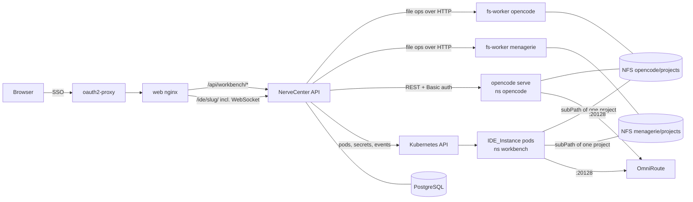

# Design Document: opencode-menagerie-workbench

## Overview

The Workbench adds a coding surface to NerveCenter: a project catalogue backed by two NFS exports, opencode session views, a bundled in-browser code editor for opencode projects, and an optional per-project browser VS Code (code-server) with the Menagerie extension. It is delivered in three gated phases (Requirement 11.2): Phase 1 storage and catalogue, Phase 2 Code_Editor with opencode Sessions, Phase 3 Browser_IDE.

### Decisions taken for the open questions

The requirements list five open questions. This design resolves them as follows. Each is an assumption the Owner can override; the "Cost of reversing" column says what would change.

| Open question | Assumption chosen | Rationale | Cost of reversing |
|---|---|---|---|
| Browser_IDE per Project or shared per kind | **Per Project.** One pod per Project, at most 2 running (Req 5.3, 5.10, 5.13). | Matches the requirements as written. A per-project `subPath` mount is the only way to meet Req 7.4 (no other project's files visible). A shared instance would need the whole store mounted. | A shared instance breaks Req 7.4 and 5.3. Not a small change. |
| Code_Editor for `menagerie` Projects | **opencode Projects only.** The editor entry point is hidden for `menagerie` Projects, and the file endpoints reject `menagerie` with 409 `editor_not_supported`. | Matches Req 4. Menagerie work happens in the Browser_IDE, which already edits files. | Low. The file endpoints are kind-agnostic (Path_Guard and file worker take a kind). Only the UI gate and one check in the API change. |
| Editor library | **Monaco-class, bundled.** `monaco-editor` loaded through Vite with `?worker` imports and `@monaco-editor/react` configured with `loader.config({ monaco })`, so nothing loads from a CDN (Req 4.13). | The owner accepted a Monaco-class editor. It gives language modes, diff and selection APIs needed for Req 4.2, 4.8, 4.10. The cost is bundle size, handled by lazy-loading the editor route. | CodeMirror 6 is the lighter alternative. Only `CodeEditor.tsx` wraps the library, so a swap is contained. |
| NFS ownership | **Configurable UID/GID.** `WORKBENCH_UID` and `WORKBENCH_GID` (default 1000, matching the existing opencode pod uid) feed every Workbench pod's `runAsUser`/`runAsGroup`. The design does not assume squash behaviour. `fsGroup` is not relied on, because Kubernetes does not apply it to NFS volumes. The NFS export must map or squash all client access to the owner of the project directories. The check script (below) fails if a created file is not owned by the configured UID/GID. | Squash behaviour on the NAS is unknown. A configurable value plus a verifying check turns an unknown into a visible, early failure. | None. This is already a setting. |
| Menagerie extension source | **Owner-supplied VSIX**, passed as a build arg `MENAGERIE_VSIX` (path in the build context) plus `MENAGERIE_VERSION`. The build fails if either is missing. No download from a marketplace. | The source and version are unknown to this spec (Assumption in requirements). | Low. |

Other design-level choices that deviate from a literal reading of the requirements are listed under **Requirement conflicts and gaps** below. Read that section before approving.

### Research summary (from the codebase)

- **Backend conventions.** FastAPI routers under `backend/api/endpoints/*.py`, registered in `backend/api/app.py` (see `handoffs.router`). Pydantic models with `model_config = {"extra": "forbid"}` and `Field` constraints (`backend/api/endpoints/handoffs.py`). Services take an `async_sessionmaker` (`backend/handoffs/service.py`). Domain packages are `backend/<name>/` with `__init__.py`, and `service.py`. SQLAlchemy models in `backend/persistence/models/`. Alembic migrations in `backend/persistence/alembic/versions/` named `NNN_name.py`, additive, with a documented `downgrade()`. The latest is `048_kube_run_cap`, so the Workbench migration is `049_workbench`.
- **Opencode client already exists.** `backend/handoffs/central.py` has `OpenCodeClient` (Basic auth from Secret `nervecenter-opencode`, `POST /api/session`, `/prompt`, wait endpoint) and `session_permissions(push_approved)` that denies `git push *` and `git remote *`. The Workbench reuses and extends this client. It does not duplicate it.
- **Local-first routing.** `backend/inference/local_first.py` has `is_local` (prefixes `local/`, `secure/`, `pool/tier1/`, `pool/tier1b/`, `vllm/`, `llama-cpp/`, `ollama-local/`). The Workbench reuses it for the "non-local" label.
- **Web conventions.** React 18, Vite, Tailwind 3, react-router 6. Views in `web/src/views/`, API clients in `web/src/api/*.ts` (for example `handoffs.ts`, `askStream.ts` for fetch-based streaming), routes in `web/src/App.tsx`, nav entries in `web/src/components/Layout.tsx`. Playwright specs in `web/tests/e2e/*.spec.ts`. There is no editor dependency today.
- **Ingress.** `deployments/kubernetes/base/ingress.yaml` sends `/` through `nervecenter-oauth` (oauth2-proxy), which proxies to the web nginx (`web/nginx.conf.template`), which fans `/api/` out to the API. A new `/ide/` location in the nginx template therefore inherits the SSO gate with no new Ingress path (Req 6.2, 6.3).
- **Optional manifests convention.** `deployments/kubernetes/optional/<name>/` with its own `kustomization.yaml` and `README.md`, not referenced from the base kustomization (`clamav`, `skillhub-upload`). `docs/central-opencode/README.md` is the style reference for the enable/rollback procedure.
- **Kubernetes access from the API.** The backend has `httpx` and `websockets` but no Kubernetes client library, and the API pod has no dedicated ServiceAccount. The Workbench talks to the Kubernetes REST API with `httpx` and a ServiceAccount token (see "IDE manager"). It does not add the `kubernetes` package.
- **No audit-log module exists.** The Audit_Log is new: a table plus a structured log line.
- **Test tooling.** `pyproject.toml` has no property-testing library. `hypothesis` is added as a dev dependency. The web side adds `fast-check` as a dev dependency for the editor-state reducer property.
- **Prior ADRs that constrain this design.** NS-ADR-106 (central opencode, default-deny, no push without approval, NerveCenter runs no code), NS-ADR-107 (local-first), NS-ADR-108 (secure no-memory routes for opencode), NS-ADR-083 (API egress unrestricted). The next free ADR number is **NS-ADR-127** (last present: NS-ADR-126).

## Architecture



### Key architectural decisions

1. **The API pod mounts neither store. Two file workers do.** Req 1.5 says no pod has both stores mounted, but the API must read and write files of both kinds. The design adds two small Deployments in namespace `workbench`, `wb-fs-opencode` and `wb-fs-menagerie`, each running the existing API image with `python -m backend.workbench.fsworker --kind <kind>` and mounting exactly one store. The worker owns all filesystem access: Path_Guard, atomic writes, directory listing, clone, free-space probe. The API calls it over cluster HTTP. This also isolates file access from the process that holds the database credentials. Trade-off: one more hop and two more Deployments. The alternative, mounting both stores in the API pod, violates Req 1.5 literally.
2. **The opencode server mounts only the Opencode_Store.** A PV/PVC pair for the same export is created in namespace `opencode` and mounted at `/projects`. A Session's working directory is `/projects/<slug>`. The existing Longhorn PVC `opencode-data` and its mount at the existing workspace path stay untouched (Req 1.9). Handoff clones continue to use it.
3. **One PV per (export, namespace).** A PersistentVolume binds to exactly one PVC, and PVCs are namespaced. The same export therefore appears as up to three PVs per kind (`workbench` fs-worker and IDE pods, `opencode` for the opencode server). All have `Retain`, `ReadWriteMany`, and mount options `nfsvers=4.1,hard`. Req 1.1 and 1.2 are met by the fs-worker PVs. Names: `wb-opencode-projects`, `wb-menagerie-projects`, `oc-opencode-projects`.
4. **The API proxies the IDE.** `/ide/<slug>/` is served by the API, which validates the SSO session and Origin (Req 6.7, 6.8), records last-traffic time (needed for the 60-minute idle stop, Req 5.9), and forwards HTTP and WebSocket traffic to the pod IP. Pod IPs come from the Kubernetes API. The NetworkPolicy admits ingress only from API pods (Req 7.8). Web pods do not talk to IDE pods directly, so ingress is limited to API pods. If the Owner wants web pods allowed as well, that is a one-line policy change, but the design does not need it.
5. **Phases are feature flags.** `WORKBENCH_PHASE` (0 to 3, default 0) is read at startup. Routers for a phase are mounted only when the flag is at least that phase. The nav entry is hidden by a `GET /api/workbench/config` response. Marking a phase complete means the Owner raises the value after reviewing the evidence file (Req 11.3 to 11.5).
6. **No handoff coupling.** Workbench Sessions never touch `coding_handoffs` (Req 10.2). The only cross-read is a read-only query for the 10 most recent handoffs (Req 3.5) and the project-slug check for the "Open in Browser IDE" link (Req 10.3).

## Components and Interfaces

### Backend package `backend/workbench/`

| Module | Responsibility |
|---|---|
| `paths.py` | `PathGuard.resolve(root, rel) -> Path` or raises `PathNotPermitted`. Pure and synchronous. Used only inside the file worker. |
| `validation.py` | `validate_slug`, `validate_title`, `validate_kind`, `validate_git_url`, `validate_message`, `validate_selection_action`, `classify_file` (size and UTF-8, Req 4.6), `language_for(path)`, `sort_tree(entries)`, `low_space(free_bytes)`, `is_local_route(model)` (wraps `backend.inference.local_first.is_local`), `needs_nonlocal_confirm`, `classify_git_command(argv, push_approved)`. All pure. |
| `store.py` | `StoreClient` (API side). Calls the fs-worker for a kind with a 10 s timeout and maps failures to `StoreUnavailable(kind)` (Req 1.8). |
| `fsworker.py` | The file worker (FastAPI app, internal only). Endpoints below. Holds a per-project semaphore of 4 for writes (Req 9.12). |
| `projects.py` | `ProjectService` (catalogue). Uses `StoreClient` and the database. Create, list, archive, delete, import, discover unregistered. |
| `files.py` | API-side facade that forwards file operations to the worker and maps errors to HTTP codes. |
| `sessions.py` | Opencode Session proxy. Extends `OpenCodeClient` with create (cwd, model), send, abort, list, and an SSE relay. |
| `ide.py` | `IdeManager`: pod spec builder (`build_pod_spec`, pure), start, stop, list, rediscovery, reaper, and the proxy. |
| `kubeclient.py` | Minimal `httpx` client for the Kubernetes REST API using the in-cluster ServiceAccount token. Only the verbs the manager needs. |
| `audit.py` | `AuditLog.record(actor, project, action, outcome)`. Writes a row and one structured log line. Caps the serialized entry at 4 KiB. |
| `usage.py` | Records per-Session model usage (Req 8.8). |
| `health.py` | Store probes and `GET /api/workbench/health`. |
| `phase.py` | Reads `WORKBENCH_PHASE` and `WORKBENCH_IDE_ENABLED`. |

New router: `backend/api/endpoints/workbench.py` with prefix `/api/workbench`, registered in `backend/api/app.py` next to `handoffs.router`. All routes depend on the existing SSO session dependency, so a missing session returns 401 before any handler code runs (Req 6.1, 6.4). The test that enumerates `router.routes` and asserts 401 without a session guards against a future route that forgets the dependency.

### HTTP interface (Workbench_API)

| Method and path | Phase | Purpose | Req |
|---|---|---|---|
| `GET /api/workbench/config` | 1 | Phase, `ide_enabled`, default models | 3.1, 5.12 |
| `GET /api/workbench/health` | 1 | Per-store `mounted`, `writable`, `free_bytes` | 9.3, 9.4 |
| `GET /api/workbench/projects` | 1 | List all projects, archived included, newest activity first | 2.1 |
| `POST /api/workbench/projects` | 1 | Create (empty or from `git_url`) | 2.2 to 2.8 |
| `GET /api/workbench/projects/{kind}/{slug}` | 1 | One project with sessions and 10 latest handoffs | 3.5 |
| `POST /api/workbench/projects/{kind}/{slug}/archive` | 1 | Archive | 2.9 |
| `DELETE /api/workbench/projects/{kind}/{slug}` | 1 | Delete, body `{confirm}` | 2.10, 2.11 |
| `GET /api/workbench/unregistered` | 1 | List directories without a record | 2.12 |
| `POST /api/workbench/projects/import` | 1 | Import one directory | 2.13 |
| `POST /api/workbench/projects/{kind}/{slug}/push-approval` | 1 | Set or clear push approval (Req 7.13) | 7.13 |
| `GET /api/workbench/projects/{slug}/files?path=` | 2 | Directory listing (one level) | 4.1 |
| `GET /api/workbench/projects/{slug}/file?path=` | 2 | Read a file; returns `mtime_ns`, size, type | 4.2, 4.6 |
| `PUT /api/workbench/projects/{slug}/file` | 2 | Save `{path, content, base_mtime_ns}` | 4.3, 4.5 |
| `POST /api/workbench/projects/{slug}/fs` | 2 | create, rename, move, delete | 4.4 |
| `GET /api/workbench/projects/{slug}/changes?since=` | 2 | Changed paths since a token (fallback for Req 4.8) | 4.8 |
| `POST /api/workbench/projects/{slug}/sessions` | 2 | Start a Session (model, `confirm_nonlocal`) | 3.6, 8.3, 8.5 |
| `GET /api/workbench/projects/{slug}/sessions` | 2 | List Sessions | 3.5 |
| `GET /api/workbench/sessions/{id}/events` | 2 | SSE stream of messages and tool summaries | 3.7 |
| `POST /api/workbench/sessions/{id}/messages` | 2 | Send a message | 3.8 |
| `POST /api/workbench/sessions/{id}/abort` | 2 | Abort | 3.10 |
| `POST /api/workbench/sessions/{id}/selection-action` | 2 | Selection, path, instruction | 4.10 |
| `GET /api/workbench/ide` | 3 | List IDE_Instances | 5.7 |
| `POST /api/workbench/ide/{kind}/{slug}/start` | 3 | Start or return existing | 5.3, 5.13 |
| `POST /api/workbench/ide/{kind}/{slug}/stop` | 3 | Stop | 5.8 |
| `GET /ide/{slug}/{path:path}` and WebSocket | 3 | Proxy to the pod | 5.7, 6.7 |

The Workbench project routes use `{slug}` without `kind` for file and session endpoints because the editor is opencode-only. The service resolves `(slug, "opencode")`. If that does not exist but a `menagerie` project with the slug does, it returns 409 `editor_not_supported`.

Methods: only the listed methods are routed. FastAPI returns 405 for any other method on a routed path. A state-changing operation is never exposed on `GET` (Req 6.9). CSRF: the Workbench reuses the existing `X-NC-Refresh`-style custom-header guard pattern from `backend/api/auth.py`. A new header `X-NC-Workbench: 1` is required on every `POST`, `PUT`, `PATCH`, `DELETE`, and a request without it that carries an `Origin` or `Sec-Fetch-Site: cross-site` is refused with 403 (Req 6.10). The web client adds the header in the Workbench API module.

### File worker interface (internal, API to worker only)

`GET /list`, `GET /read`, `PUT /write`, `POST /op`, `POST /mkproject`, `POST /clone`, `POST /rmproject`, `GET /dirs`, `GET /stat`, `GET /probe`. Every endpoint that takes a path calls `PathGuard.resolve` first. The worker is reachable only from API pods (NetworkPolicy). It has no credentials besides its mount.

**Path_Guard algorithm** (`paths.py`): reject if the string is empty-after-normalisation is allowed only where the operation is on the root itself (list). Otherwise reject if longer than 4096 characters, contains a NUL, is absolute (starts with `/` or a drive-like or UNC prefix), contains a `..` segment after splitting on `/` and `\`, or contains encoded separators or dot segments after one round of percent-decoding (`%2e`, `%2f`, `%5c`). Then join to the root and call `os.path.realpath`. Accept only if `realpath(root)` is a path prefix of the result (compared with `os.path.commonpath`). For operations that create a new leaf, resolve the parent and check the parent, then append the validated final component. Symlinks whose target is outside the root are rejected by the `realpath` check. The final open uses `O_NOFOLLOW` on the leaf to narrow the check-then-use window.

**Atomic write**: write to a temp file in the same directory, `fsync`, compare the on-disk `st_mtime_ns` with `base_mtime_ns` while holding a per-file `flock`, `os.replace`, `fsync` the directory, and return the new `st_mtime_ns`. Limitation: NFS `flock` is advisory and the compare-then-replace is not atomic across NFS clients. This is acceptable for a single-owner system where the only other writers are opencode and the Owner's IDE. It is stated here so nobody assumes stronger guarantees.

### IDE manager (`ide.py`)

`build_pod_spec(project, config, key_secret_name) -> dict` is a pure function. The pod it produces:

- Namespace `workbench`, labels `app=ide`, `workbench/project=<slug>`, `workbench/kind=<kind>`.
- One volume: the PVC for the project's kind, mounted at `/home/coder/project` with `subPath: <slug>`. No other store or path (Req 7.4, 5.4, 5.5).
- `securityContext`: `runAsNonRoot: true`, `runAsUser: $WORKBENCH_UID`, `runAsGroup: $WORKBENCH_GID`, `allowPrivilegeEscalation: false`, `capabilities.drop: [ALL]`, `readOnlyRootFilesystem: true`, `seccompProfile.type: RuntimeDefault`. Writable `emptyDir` volumes for `/tmp`, `/home/coder/.local`, `/home/coder/.config` only (Req 7.5).
- Non-zero `requests` and `limits` for CPU and memory on every container (Req 7.6). Defaults: 250m/1Gi requests, 2 CPU/3Gi limits, overridable by env.
- `automountServiceAccountToken: false` (Req 7.11).
- Env: `ROO_CODE_IPC_SOCKET_PATH=/tmp/menagerie/ipc.sock` (Req 5.6), code-server started with `--auth none` (Req 6.6), `WORKBENCH_PUSH_APPROVED`, and the OmniRoute key by `secretKeyRef` (Req 8.7).
- Image pinned by digest (Req 5.2).

**Start flow**: check max 2 running, check no existing pod for the project (return it, Req 5.13), create the per-IDE Secret holding a newly issued OmniRoute client key (Req 7.12, issuance reuses the existing `backend/api/endpoints/omniroute_keys.py` machinery), create the pod with an `ownerReference` on the Secret so it is deleted with the pod, wait up to 120 s for Ready, on timeout delete the pod and Secret and return the last pod event message (Req 5.11).

**Reaper and rediscovery**: a background task on the existing agent-runner tick style (15 s) deletes IDE pods whose last traffic is older than 60 minutes (Req 5.9). `last_traffic_at` lives in table `workbench_ide`, updated by the proxy at most once per 30 s per pod to avoid write amplification. On API startup, `rediscover()` lists pods by label `app=ide` and rebuilds the registry within 30 s (Req 9.7). The Kubernetes API is the source of truth for what is running. The database row only carries `last_traffic_at`.

**ServiceAccount and RBAC**: a new ServiceAccount `nervecenter-workbench` in namespace `nervecenter`, plus a Role in namespace `workbench` allowing `get, list, watch, create, delete` on `pods`, `get, create, delete` on `secrets`, and `list` on `events`. The `optional/workbench` overlay patches the `api` Deployment to use that ServiceAccount. No ClusterRole. The API token is therefore able to create pods only in `workbench`.

**Metrics and logs**: `ide.started`, `ide.stopped`, `ide.failed`, `ide.idle_stopped` counters through the existing `backend/observability` module, one structured log line per event with project id, IDE id, event type and timestamp (Req 9.6).

### Opencode session proxy (`sessions.py`)

Wraps `OpenCodeClient`. New session creation sends `{location: /projects/<slug>, model, small_model, permissions}`. `permissions` come from `session_permissions(push_approved)`. The SSE relay reads the opencode event stream, filters to the Session's id, forwards events in received order, and emits file-edit events as `{type: "file_changed", path}` that the editor uses for Req 4.8. Timeouts: 5 s connect and first-byte for requests (Req 3.12), 10 s wait for abort confirmation (Req 3.10). The exact opencode event names and the abort endpoint must be confirmed against the pinned image version (`2.3.0`) during implementation. The existing `central.py` only uses create, prompt and wait.

### Web components

| File | Role |
|---|---|
| `web/src/api/workbench.ts` | Axios client following `handoffs.ts`. Adds `X-NC-Workbench: 1`. SSE helper modeled on `askStream.ts`. |
| `web/src/views/WorkbenchView.tsx` | `/workbench`. Projects grouped by kind, archived filter, low-space banner, create dialog. |
| `web/src/views/WorkbenchProjectView.tsx` | `/workbench/:kind/:slug`. Sessions, 10 latest handoffs, links to editor and IDE. |
| `web/src/views/WorkbenchEditorView.tsx` | `/workbench/:slug/edit`. File tree, tabs, editor, session side panel. |
| `web/src/components/workbench/CodeEditor.tsx` | The only module that imports Monaco. Lazy-loaded. |
| `web/src/components/workbench/editorState.ts` | Pure reducer for tabs, dirty flags and external-change notices. |
| `web/src/components/workbench/SessionPanel.tsx` | Stream, message box, abort, model selector with "non-local" label and confirm. |
| `web/src/components/workbench/IdeFrame.tsx` | Controls and the `/ide/<slug>/` iframe. Hidden when `ide_enabled` is false. |

`Layout.tsx` gets a Workbench nav entry shown when `config.phase >= 1`. `HandoffsView` gets the conditional "Open in Browser IDE" link (Req 10.3 to 10.5). It is a plain anchor, with no state change. Errors use `role="alert"` (Req 3.13). The editor `beforeunload` handler is registered while any tab is dirty (Req 4.7).

`web/nginx.conf.template` gets a `location /ide/` block that proxies to the API with `proxy_http_version 1.1`, `Upgrade` and `Connection` headers, and long read timeouts. It must preserve the `Origin` header.

### Deployment artifacts (`deployments/kubernetes/optional/workbench/`)

`namespace.yaml` (`workbench`, with `pod-security.kubernetes.io/enforce: restricted`), `pv-pvc-opencode.yaml`, `pv-pvc-menagerie.yaml`, `pv-pvc-opencode-ns.yaml` (the `opencode` namespace claim), `fsworker.yaml`, `networkpolicy.yaml`, `rbac.yaml`, `api-patch.yaml`, `kustomization.yaml`, `README.md` (enable and rollback), and `nfs-check.sh` (Req 1.10). The base `kustomization.yaml` does not reference the folder (Req 9.1). Docs: `docs/workbench/README.md` in the style of `docs/central-opencode/README.md`, with enable steps (command plus confirming check), rollback steps that delete nothing on the exports, the NFS mount-option rationale, and the backup and restore check (Req 9.2, 9.9, 9.11).

`nfs-check.sh` takes `WORKBENCH_UID` and `WORKBENCH_GID`. For each export it mounts (or uses an existing mount), lists, writes a marker, reads it back, checks ownership equals the configured UID/GID, removes it, and exits non-zero naming the failing export.

**NetworkPolicy (namespace `workbench`)**: `default-deny` for Ingress and Egress on all pods. Then: IDE ingress on the code-server port from API pods (namespaceSelector `nervecenter`, podSelector `app: api`); fs-worker ingress on its port from API pods; egress for IDE pods to kube-dns, to OmniRoute pods on TCP 20128, and to TCP 443 and 22 with `ipBlock: 0.0.0.0/0` and `except` for `10.0.0.0/8`, `172.16.0.0/12`, `192.168.0.0/16`, `169.254.0.0/16`. NFS traffic is node-level (kubelet mounts), so pods need no NFS egress. fs-workers get no egress except DNS, and egress to `git` remotes only for the clone operation: clone runs in the worker, so the worker also gets the same 443/22 public rule. Deny to the API server and the database follows from the default-deny plus the exclusion of private ranges. The OmniRoute pod selector must be copied from `docs/central-opencode/networkpolicy.yaml`.

### Opencode server changes (outside this repo's base)

The central opencode manifests live in `~/sources/kube/opencode`, mirrored at `docs/central-opencode`. Phase 2 adds an NFS PVC mount `/projects` to that Deployment and a Workbench note in the mirror. The `opencode-data` PVC and its mount are untouched. The opencode config gets the same OmniRoute-only provider block it has today. No API keys are added.

## Data Models

Migration `049_workbench` (additive only, `down_revision = "048_kube_run_cap"`, downgrade drops only the tables it created).

```text
workbench_projects
  id            uuid pk
  slug          text not null    -- ^[a-z0-9][a-z0-9-]{0,62}$ (also CHECKed in SQL)
  kind          text not null    -- CHECK kind IN ('opencode','menagerie')
  title         text not null    -- CHECK char_length BETWEEN 1 AND 120
  created_at    timestamptz not null
  last_activity_at timestamptz not null
  size_bytes    bigint not null default 0
  archived      boolean not null default false
  push_approved boolean not null default false
  UNIQUE (slug, kind)

workbench_sessions            -- mirror of opencode sessions for listing and usage
  id            text pk       -- opencode session id
  project_id    uuid fk -> workbench_projects
  title         text, status text, updated_at timestamptz
  model         text, small_model text

workbench_model_usage         -- Req 8.8; no prompt or completion text columns exist
  id bigserial pk, session_id text, model text,
  input_tokens int, output_tokens int, recorded_at timestamptz

workbench_ide
  project_id    uuid pk fk -> workbench_projects
  pod_name      text, state text, last_traffic_at timestamptz, started_at timestamptz

workbench_audit
  id bigserial pk, at timestamptz, actor text, project_slug text,
  action text, outcome text   -- CHECK outcome IN ('success','failure')
```

`size_bytes` is refreshed by the file worker on project open and by a periodic scan, and is allowed to be slightly stale. `last_activity_at` updates on writes, session messages and IDE start.

Pydantic request models use `extra="forbid"`:

```python
class ProjectIn(BaseModel):
    slug: str                      # validated by validate_slug
    title: str = Field(min_length=1, max_length=120)
    kind: Literal["opencode", "menagerie"]
    git_url: str | None = None     # https or ssh scheme only
class FileSaveIn(BaseModel):
    path: str; content: str; base_mtime_ns: int
class SessionIn(BaseModel):
    model: str | None = None; small_model: str | None = None
    confirm_nonlocal: bool = False
class MessageIn(BaseModel):
    text: str = Field(min_length=1, max_length=20_000)
class SelectionActionIn(BaseModel):
    selection: str = Field(max_length=100_000); path: str
    instruction: str = Field(min_length=1, max_length=10_000)
```

Session defaults: the primary model is `omniroute/local/code` and the small model is `local/fast` (Req 8.3), read from `WORKBENCH_DEFAULT_MODEL` and `WORKBENCH_DEFAULT_SMALL_MODEL`.

## Requirement conflicts and gaps

These came up while mapping requirements onto the codebase. Each has a stated resolution so the design is internally consistent. The Owner should confirm them.

1. **Req 1.5 versus the API needing both stores.** Resolved with the two file workers above. If the Owner reads 1.5 as "stores are not mounted into IDE pods of the wrong kind," the workers can be dropped and the API can mount both stores. This would remove two Deployments.
2. **Req 8.3 versus NS-ADR-108.** NS-ADR-108 moved central opencode to `omniroute/secure/coder` and `secure/reader` (no-memory, tier-1 cap). Req 8.3 says `omniroute/local/code` and `local/fast`. The design makes both defaults configurable and defaults to the literal values in Req 8.3. The Owner should decide whether Workbench Sessions should use the secure routes, since they carry the Owner's source code. The "non-local" check uses the existing `is_local`, which treats `secure/*` as local. Req 8.5 names only `local/code` and `local/fast` as local routes. The design takes the broader rule, so `secure/*` does not trigger a warning. This is a deliberate deviation.
3. **Req 8.2 versus Req 7.9.** Req 7.9 allows IDE egress to TCP 443 on public addresses (needed for git over https). A NetworkPolicy cannot tell a model call from a git call. Req 8.2 (block model requests to other hosts and surface an error within 5 s) is therefore met by configuration only: the opencode and extension configs list OmniRoute as the single provider, and no other provider key exists anywhere in the image or pod (Req 8.4). A request to another host would fail for lack of credentials, but the Workbench does not detect or report it as "only OmniRoute is permitted". A real enforcement point would be an egress proxy with a host allowlist. That is out of scope here and listed as a follow-up.
4. **Req 3.11 mechanism.** The requirements do not say how the Menagerie extension reports task status. The design assumes the IDE image ships a small `menagerie-status` HTTP endpoint on a second port that reads the extension's IPC socket, and the API polls it through the same NetworkPolicy path. This is untested against the real extension and depends on the VSIX the Owner supplies. If the IPC protocol cannot provide task status, Req 3.11 cannot be met as written.
5. **Req 5.7 route versus slug uniqueness.** Projects are unique by `(slug, kind)` (Req 2.5), but the IDE route is `/ide/<project-slug>/`. If the same slug exists in both kinds, the IDE start for that slug returns 409 `ambiguous_slug`. The Owner can avoid this by not reusing slugs across kinds.
6. **Req 7.13 enforcement in the IDE.** For the opencode Session, push is denied by the permission rules from `session_permissions`. In the IDE, the image puts a `git` wrapper first on `PATH` that applies `classify_git_command`, and the Project's `push_approved` flag is passed in the environment at pod start. That is a guard rail against mistakes, not a security boundary: a terminal user can call `/usr/bin/git` directly. The hard limit is that no git credentials are mounted into the pod, so an unapproved push cannot authenticate. The wrapper is documented with that limit.
7. **Req 6.11 audit log.** No audit-log facility exists. The design adds the `workbench_audit` table and a structured log line. It does not retrofit auditing to other features.
8. **Req 4.5 and NFS.** Optimistic concurrency uses `mtime_ns`. NFS attribute caching can make `mtime` look stale for a few seconds on a different client. The fs-worker is the only writer from NerveCenter's side and reads `st_mtime_ns` with a fresh `stat` after `open`. opencode and IDE writes come from other nodes, so a conflict window of a few seconds is possible. Mount option `noac` would remove it at a performance cost and is not set. This is documented as a known limit.

## Correctness Properties

*A property is a characteristic or behavior that should hold true across all valid executions of a system-essentially, a formal statement about what the system should do. Properties serve as the bridge between human-readable specifications and machine-verifiable correctness guarantees.*

Reflection on the prework: it produced about 45 testable criteria. Criteria that are consequences of another were merged: 4.12 and 7.1 to 7.3 into Property 1; 1.6, 1.7, 2.2 and 2.15 into Property 3; 3.3 and 3.4 into Property 5; 5.3 to 5.6, 6.6, 7.4 to 7.6, 7.11 and 7.12 into Property 14; 6.9 and 6.10 into Property 18; 10.3 and 10.4 with the handoff selection of 3.5 into Property 27. Criteria about timing, cluster enforcement, manifests and UI interaction are covered by integration, smoke and end-to-end tests in the Testing Strategy, not by properties.

### Property 1: Path_Guard containment

*For any* path string (including empty, 4096 characters or fewer, over-length, Unicode, percent-encoded separators, NUL bytes, absolute paths, `..` segments) and any project directory that may contain symlinks, `PathGuard.resolve` either returns a path whose real path is inside the Project_Root, or raises `PathNotPermitted`. No file operation changes any file when `resolve` raises.

**Validates: Requirements 4.12, 7.1, 7.2, 7.3, 11.6**

### Property 2: Input validation rejects without side effects

*For any* slug, title, kind and git URL, project creation succeeds only when the slug matches `^[a-z0-9][a-z0-9-]{0,62}$`, the title has 1 to 120 characters, the kind is `opencode` or `menagerie`, and any git URL uses scheme `https` or `ssh`. Otherwise it is rejected, no Project_Root is created and no record is written.

**Validates: Requirements 2.3, 2.4, 2.7, 11.6**

### Property 3: Project create then read round trip and store placement

*For any* valid slug, title and kind, creating a Project and reading it back returns the same slug, title and kind, and its Project_Root exists under exactly the store for that kind and under no other store.

**Validates: Requirements 1.6, 1.7, 2.2, 2.15, 11.6**

### Property 4: Lifecycle operations preserve files

*For any* Project directory tree, archiving the Project, listing unregistered directories, and importing an unregistered directory leave every file byte-identical. Deletion removes the Project only when the confirmation equals the slug, and any other confirmation leaves the tree and the record unchanged.

**Validates: Requirements 2.9, 2.10, 2.11, 2.12, 2.13**

### Property 5: Project list ordering and grouping

*For any* set of Projects and archived-filter setting, the list is ordered by last-activity time descending, includes archived Projects, and the grouped view contains one group per kind whose count equals its visible Projects, with archived Projects visible only when the filter is on.

**Validates: Requirements 2.1, 3.3, 3.4**

### Property 6: File save and read round trip

*For any* text content up to 2 MiB, including mixed `\n` and `\r\n` line endings and with or without a trailing newline, saving a file and reading it back returns identical bytes.

**Validates: Requirements 4.14, 11.6**

### Property 7: Stale saves are rejected

*For any* file and any save whose `base_mtime_ns` differs from the file's current `st_mtime_ns`, the save is rejected with a conflict that carries the current mtime, and the on-disk bytes are unchanged.

**Validates: Requirements 4.5**

### Property 8: File operations match a model filesystem

*For any* sequence of create, rename, move and delete operations on paths inside a Project_Root, the resulting directory tree equals the tree produced by applying the same operations to an in-memory model, and no entry exists outside the Project_Root.

**Validates: Requirements 4.4**

### Property 9: File classification

*For any* byte string and size, `classify_file` marks the file openable if and only if its size is at most 2,097,152 bytes and it is valid UTF-8. A refused file's report carries its exact size in bytes.

**Validates: Requirements 4.6**

### Property 10: File tree ordering and language selection

*For any* list of directory entries, `sort_tree` places all directories before all files and orders names ascending within each group. *For any* file name, `language_for` returns the mapped language when the extension is known and `plaintext` otherwise.

**Validates: Requirements 4.1, 4.2**

### Property 11: Unsaved edits are never clobbered

*For any* sequence of editor events (edit, save, external-change notice, reload), the buffer of a dirty tab is unchanged by an external-change notice, and changes only on an explicit reload or a successful save.

**Validates: Requirements 4.8, 4.9**

### Property 12: Message and selection limits

*For any* message length and session state, a message is accepted if and only if its length is 1 to 20,000 characters and the Session is running. *For any* selection length, instruction length and session presence, a selection action is sent if and only if the selection is at most 100,000 characters, the instruction is at most 10,000 characters, and a Session is active.

**Validates: Requirements 3.8, 3.9, 4.10, 4.11**

### Property 13: Stream order preservation

*For any* sequence of opencode events for a Session, the relay emits them to the client in the order received and emits none for other Sessions.

**Validates: Requirements 3.7**

### Property 14: IDE pod spec invariants

*For any* Project and valid configuration, `build_pod_spec` produces a pod in namespace `workbench` with exactly one volume of the project's kind mounted by `subPath` equal to the slug, no mount of the whole store or another project, `ROO_CODE_IPC_SOCKET_PATH` set, code-server auth disabled, a non-zero `runAsUser`, `allowPrivilegeEscalation: false`, all capabilities dropped, `readOnlyRootFilesystem: true`, `RuntimeDefault` seccomp, non-zero CPU and memory requests and limits on every container, `automountServiceAccountToken: false`, and referencing no Secret other than the per-IDE OmniRoute key.

**Validates: Requirements 5.3, 5.4, 5.5, 5.6, 6.6, 7.4, 7.5, 7.6, 7.11, 7.12, 8.7**

### Property 15: IDE registry limits

*For any* sequence of start and stop requests against a fake cluster, the number of running IDE_Instances never exceeds 2, at most one pod exists per Project, a start request for a Project that already has one returns the existing pod, and rebuilding the registry from the set of labeled pods yields exactly that set.

**Validates: Requirements 5.10, 5.13, 9.7**

### Property 16: Idle reaper decision

*For any* set of IDE_Instances with last-traffic times and a clock value, the reaper selects an instance if and only if its idle time is at least 60 minutes.

**Validates: Requirements 5.9**

### Property 17: IDE routing isolation

*For any* slug and set of IDE_Instances, the resolved upstream is the instance of the Project with that slug, or none when it has no instance. It is never another Project's instance.

**Validates: Requirements 5.7**

### Property 18: Request gates (WebSocket Origin, session, method, CSRF)

*For any* combination of session validity and `Origin` header, an IDE WebSocket upgrade is accepted only with a valid session and an `Origin` equal to the Workbench host. A missing session yields 401, a missing or non-matching `Origin` yields 403, and no upstream connection is opened on refusal. *For any* HTTP method and header set, a state-changing Workbench request without the CSRF header returns 403 and performs no operation, and a method outside `POST`, `PUT`, `PATCH`, `DELETE` on a state-changing path returns 405.

**Validates: Requirements 6.7, 6.8, 6.9, 6.10**

### Property 19: Audit entries

*For any* Workbench action and outcome with arbitrary payload contents, exactly one Audit_Log entry is written containing the actor, project slug, action and outcome, its serialized size is at most 4 KiB, and it contains none of the payload text.

**Validates: Requirements 6.11, 6.12**

### Property 20: Secrets are never disclosed

*For any* configured Opencode_Server password value, no Workbench_API response body, response header or browser-visible log line contains that value.

**Validates: Requirements 6.5**

### Property 21: Git push policy

*For any* git command line and approval state, `classify_git_command` denies `push` and any remote add, set-url, rename or remove when the Project is not approved, and allows other commands.

**Validates: Requirements 7.13**

### Property 22: Model locality and confirmation

*For any* OmniRoute route name, the model selector shows the "non-local" label if and only if `is_local_route` is false. A Session on a non-local route starts only when the request carries `confirm_nonlocal`, and a declined confirmation starts no Session. The generated opencode configuration lists OmniRoute as its only provider and contains no API key.

**Validates: Requirements 8.1, 8.5, 8.6**

### Property 23: Usage records are content-free

*For any* completed model request, the stored usage row contains the session id, model name, input tokens, output tokens and timestamp, and no prompt or completion text.

**Validates: Requirements 8.8**

### Property 24: Low-space warning threshold

*For any* free-space value in bytes, `low_space` is true if and only if the value is below 5,368,709,120.

**Validates: Requirements 9.5**

### Property 25: IDE lifecycle events are logged and counted once

*For any* sequence of IDE events, each event produces exactly one structured log entry with project id, IDE id, event type and timestamp and no file contents or file names, and increments the counter for its event type by exactly one.

**Validates: Requirements 9.6**

### Property 26: Write concurrency cap

*For any* number N of concurrent write requests to one Project, at most 4 are in progress at once, each request beyond the fourth is rejected with the concurrency-limit error, and the in-progress writes complete unaffected.

**Validates: Requirements 9.12**

### Property 27: Handoff selection and the Browser IDE link

*For any* list of handoffs, the Project view shows the 10 most recent in newest-first order. *For any* handoff and set of Projects, the "Open in Browser IDE" link is shown if and only if the handoff targets `menagerie` and a `menagerie` Project exists whose slug equals the handoff's repo slug.

**Validates: Requirements 3.5, 10.3, 10.4**

## Error Handling

| Condition | Response | Req |
|---|---|---|
| No SSO session | 401, no operation | 6.4 |
| Missing CSRF header on state-changing request | 403 | 6.10 |
| Wrong method on a state-changing path | 405 | 6.9 |
| Invalid slug, title, kind, git scheme | 422 with field errors, no side effects | 2.3, 2.4, 2.7 |
| Slug and kind already exist | 409 `project_exists` | 2.5 |
| Delete without matching confirmation | 422, nothing changed | 2.11 |
| Store unmounted or no response in 10 s | 503 `store_unavailable` naming the store; other store keeps serving; no partial Project_Root (create writes to `.tmp-<id>` and renames) | 1.8 |
| Clone fails or exceeds 300 s | Abort process, remove partial directory, no record, 502 `clone_failed` or `clone_timeout` | 2.8 |
| Path not permitted | 400 `path_not_permitted`, nothing changed | 4.12, 7.2 |
| Save with stale mtime | 409 `conflict` with current `mtime_ns` | 4.5 |
| File over 2 MiB or not UTF-8 | 415 `not_editable` with size and detected type | 4.6 |
| Write concurrency cap | 429 `concurrency_limit` | 9.12 |
| Opencode unreachable or no response in 5 s | 503 `opencode_unavailable`; UI shows the unavailable state and keeps the project list and editor link usable | 3.12 |
| Abort not confirmed in 10 s | 504, Session stays shown as running | 3.10 |
| Invalid message or action | 422 and the UI keeps the entered text | 3.9, 4.11 |
| Non-local model without confirmation | 409 `nonlocal_confirm_required` | 8.5 |
| Third IDE_Instance | 409 `ide_limit_reached` | 5.10 |
| IDE not ready in 120 s | Pod and Secret deleted, 504 `ide_start_timeout` with the last pod event message | 5.11 |
| Slug exists in both kinds | 409 `ambiguous_slug` on IDE start | gap 5 |
| Menagerie project on editor endpoints | 409 `editor_not_supported` | open question |
| NFS down at pod start | Pod stays Pending with the mount event visible; no fallback to local storage (`emptyDir` is never used for project data) | 9.10 |
| Probe timeout (health) | Store reported `mounted: false, writable: false, free_bytes: null`; other store still reported | 9.4 |

Cleanup order on failure is deliberate: for IDE start, delete the pod first, then the Secret. For create-from-git, delete the partial directory before returning. Every failure path writes one audit entry with outcome `failure`.

## Testing Strategy

PBT applies to this feature: the Path_Guard, validators, ordering functions, pod-spec builder, registry model and reaper are pure or have a small in-memory model. It does not apply to the Kubernetes manifests, NetworkPolicies, NFS behaviour, React rendering and timing bounds, which use the other test types below.

### Property-based tests

- **Library:** `hypothesis` (Python, added to the dev dependencies in `pyproject.toml`) for Properties 1 to 10, 12 to 14 and 16 to 26. `fast-check` (added to `web/package.json` devDependencies) for Properties 11 and 27's UI predicate. Property 27's selection of 10 newest is tested in Python and its link predicate in TypeScript, since the predicate runs in the UI.
- Do not implement property testing from scratch.
- Minimum 100 examples per property (`@settings(max_examples=100)` or higher, `fc.assert(..., { numRuns: 100 })`).
- Each property is one test, tagged with a comment: `# Feature: opencode-menagerie-workbench, Property N: <property text>`.
- Generators: Property 1 uses a custom strategy that mixes random text, `..`, `%2e%2e`, NUL, absolute prefixes and a temp directory containing symlinks that point inside and outside the root. Properties 6 and 7 use `st.binary` filtered to valid UTF-8 plus line-ending mixes. Property 8 uses `hypothesis.stateful.RuleBasedStateMachine`. Property 15 uses a state machine over a fake cluster client.
- Files live in `tests/backend/workbench/`. Web tests live in `web/src/components/workbench/__tests__/`.

### Unit and example tests

- Required by Req 11.6 (each exists as a named test): Path_Guard rejects `..`, absolute, symlink-escape and NUL paths; slug validation accepts valid and rejects empty, over-length and disallowed-character slugs; create, save, read back returns identical content; a request without authentication is rejected and returns or changes no Project data.
- Route-enumeration test: every route on the Workbench router returns 401 without a session.
- Failure injection: store timeout leaves the other store usable and creates no partial root (1.8); clone failure and timeout remove the partial directory (2.8); opencode timeout shows the unavailable state (3.12); abort not confirmed in 10 s (3.10); health probe timeout (9.4); IDE start timeout cleans up (5.11).
- Handoff regression (Req 10): the existing `tests/backend` handoff tests are unchanged and must stay green. A new test counts `coding_handoffs` rows and their contents before and after a Session start. The `HandoffAgent` tests in `tests/apple` are unchanged.
- Migration test: `049_workbench` upgrades and downgrades on a scratch database, and a scan of the revision's operations finds no drop or alter of existing tables or columns (Req 2.14).
- Secret test: a canned password is set, and responses and logs from every endpoint are searched for it (Property 20 uses random values; this is the fixed regression).

### Smoke and manifest tests

- `kustomize build deployments/kubernetes/optional/workbench` renders. A test asserts: both PVs have `Retain`, `ReadWriteMany` and `nfsvers=4.1,hard`; no Pod template mounts both stores; the base kustomization does not reference the folder; no new Ingress path exists; the `opencode-data` PVC manifest is byte-identical to the mirror; the IDE image build file pins code-server and the extension to exact versions; no provider API key pattern appears in the image build context.
- `nfs-check.sh` is tested against a temp directory through an environment override (exit 0 on success, non-zero naming the export when one path is unwritable).

### Integration tests (live cluster, run by the Owner at each phase gate)

- PVCs reach `Bound` within 60 s; the NFS check script from a node; ownership matches `WORKBENCH_UID`/`WORKBENCH_GID`.
- NetworkPolicy probe: a throwaway pod in `workbench` attempts connections to the NerveCenter database, API port, Kubernetes API server, `169.254.169.254` and an RFC 1918 address, and each must fail (Req 7.10). It must succeed for DNS, OmniRoute `:20128`, and a public host on 443.
- IDE start, ready, stop within 30 s, idle stop (with the idle limit shortened by env for the test), pod reschedule keeping files, NFS unreachable leaves the pod Pending.
- Opencode: start a Session, stream, send, abort, confirm file edits arrive at the editor within 5 s.
- Phase gate evidence (Req 11.4, 11.5): each phase writes `docs/workbench/evidence-phase-N.md` containing the test count, pass count, fail count and run date. The Owner raises `WORKBENCH_PHASE` only after reviewing it, and a failing count keeps the phase incomplete.

### End-to-end (Playwright)

`web/tests/e2e/workbench.spec.ts`: opens the Code_Editor for a Project, edits a file, saves, reloads, and finds the saved content unchanged (Req 11.7). Further cases: unsaved indicator and `beforeunload` prompt (4.7), same-origin-only request check (4.13), archived filter (3.4), low-space banner appears and clears (9.5), controls hidden when the IDE is disabled (5.12), "Open in Browser IDE" link shown and hidden (10.3 to 10.5), and the model-policy panel shows Session usage (8.9). The Playwright stack uses the repository's existing `global-setup.mjs` and helpers.

### Phase mapping

| Phase | Backend | Web | Manifests | Gate |
|---|---|---|---|---|
| 1 | storage, catalogue, health, audit, ADR-127 | WorkbenchView, project view | namespace, PVs, fs-workers, NetworkPolicy | `nfs-check.sh` passes, Properties 2 to 5, 24 pass |
| 2 | files, sessions, usage | editor, session panel | opencode `/projects` mount | Properties 1, 6 to 13, 22, 23 and the Playwright round trip pass |
| 3 | IDE manager and proxy | IdeFrame, handoff link | IDE image, RBAC, `/ide/` nginx | Properties 14 to 18, 25, 26 pass and live NetworkPolicy probe passes |

Properties 19 to 21 and 26 cover code shared across phases and are required from the phase in which the code first ships.

### ADR (Req 11.1)

`NS-ADR-127`, status PROPOSED until the Owner accepts it, is appended to `.kiro/specs/nerve-shield/decisions.md` with three separate sections: (a) extension of NS-ADR-106 to in-cluster interactive code execution, including that NerveCenter's API still runs no user code itself (code runs in opencode and IDE pods), (b) storage design (two exports, PV per namespace, file workers), (c) isolation model (per-project pod, `subPath`, security context, NetworkPolicy, per-IDE key, no ServiceAccount token). A test checks that the identifier is unique and the three sections exist.
